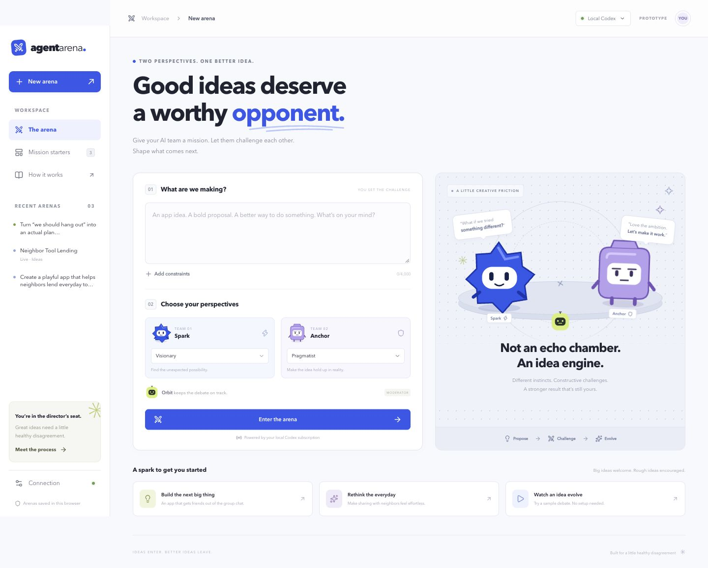

# Agent Arena

**Ideas enter. Better ideas leave.**

A playful space where two AI perspectives challenge an idea, respond to your direction, and turn it into an editable product blueprint. Built as a functional prototype for FIG AI Design Makeathon 2026, Track 1.



## Try it locally

Requires Node.js 22.13+ and a Codex account with available usage.

```sh
npm ci
npx codex login
npm run dev
```

Open the localhost URL printed in your terminal. If you already use Codex, the included CLI reuses your existing sign-in. No API key is needed. Your global Codex installation is unchanged.

The project includes a pinned official Codex CLI because older CLIs can reject newer subscription models. Blank model preferences use the top-level model from your local Codex configuration, falling back to the CLI default. If your account rejects that model, choose an available model in **Connection → Model preferences**.

The hosted private preview runs the **authored sample** only. It cannot access the Codex subscription on your computer. To use your own prompts with real AI, run locally.

## The experience

1. **Set the mission.** Describe what you want to make and choose each agent’s role.
2. **Approve the brief.** Orbit splits your mission into questions and success criteria. Edit the mission and questions before proceeding.
3. **Opening ideas.** Spark and Anchor propose independently, without seeing each other’s opening answer.
4. **Crossfire.** Each agent challenges specific claims from the other proposal and suggests alternatives.
5. **Direct the debate.** Pin useful claims and add constraints between rounds. Each next round waits for your click.
6. **Refine.** Agents explain what they adopt, revise, defend, or concede.
7. **Take the blueprint.** Orbit synthesizes the discussion into an MVP brief. Edit it, copy it, or export Markdown.

Six perspectives are available: Visionary, Pragmatist, User advocate, Contrarian, Strategist, and Craftsperson. These are separate prompted turns, not claims of independent model identities.

One complete live arena uses eight Codex calls: one brief, two openings, two critiques, two revisions, and one synthesis. Team turns run concurrently, with a maximum of two active calls. Live use consumes your subscription allowance; it is not unlimited or free inference.

## Demo in 90 seconds

Select **Watch an idea evolve** for the reliable, clearly labeled Sidequest sample. Review the brief, start the opening round, pin a claim, and proceed to Crossfire. Add a direction, refine, and show the final editable blueprint.

For a live demo, try: “Create a playful app that helps neighbors lend everyday tools without awkward group chats. Buildable in two days. No payments, ratings, or location tracking.” After Crossfire add: “Use a shared shelf for one apartment building. No maps or reputation scores.” Show how the revisions and final blueprint reflect that intervention. Live rounds may take a minute each.

## Development

```sh
npm test
npm run typecheck
npm run build
```

React 19, TypeScript, Vinext/Vite, and custom CSS. Avatars are original SVG artwork. Hosted builds run on a Cloudflare Worker using the Sites starter; local live inference is a Vite development middleware and is deliberately absent from hosted builds. `npm start` previews the production sample build; use `npm run dev` for live Codex.

Main files:

- `app/page.tsx`: setup, round controls, intervention, history, and blueprint editor.
- `app/globals.css`: responsive interface and motion.
- `lib/debate-contract.mjs`: stage prompts, request validation, output contracts.
- `scripts/codex-provider.mjs`: bounded, cancellable Codex subprocesses.
- `scripts/vite/arena-local-plugin.mjs`: localhost-only live endpoint with same-origin checks.
- `lib/sample.ts`: explicitly authored walkthrough.

Optional environment variables: `ARENA_CODEX_BIN`, `ARENA_TEAM_MODEL`, and `ARENA_MODERATOR_MODEL`. Model fields in the interface override environment defaults. Choose a lighter moderator only if that model is available to your Codex account.

## Data and limits

- The most recent 12 arenas are saved in this browser’s local storage. There is no server database or cross-device sync. Export anything you want to keep.
- Prompts and debate history are sent through Codex to generate live responses. Credentials are handled by Codex, never by the browser or repository.
- Turns use a temporary working directory, ephemeral sessions, read-only sandboxing, and disabled shell, web, plugin, app, browser, computer, hook, and multi-agent features. User configuration is ignored except for the selected model preference. Temporary response files are removed after each turn.
- Requests have size limits, structured-response validation, and a 150-second timeout. Stop cancels the current round; completed rounds stay saved. A failed two-agent round can be retried as a whole.
- The sample is fixed content. It saves director notes but does not dynamically generate a new debate for arbitrary prompts.
- This is an idea-development prototype, not a code generator. The result is a product/MVP blueprint. Agreement between agents is not evidence that a claim is true; assumptions and open questions remain visible.

## Track 1 design focus

The human-control moment is explicit: the agents propose and challenge, then pause for the director to pin a claim or introduce a constraint. The next revision shows what changed, and the human edits the final artifact. The prototype makes a multi-agent workflow understandable through named characters, distinct phases, specific rebuttals, and visible pause points.

This repository is a prototype deliverable; event submission, final pitch materials, and changing the preview’s private audience are separate steps.
