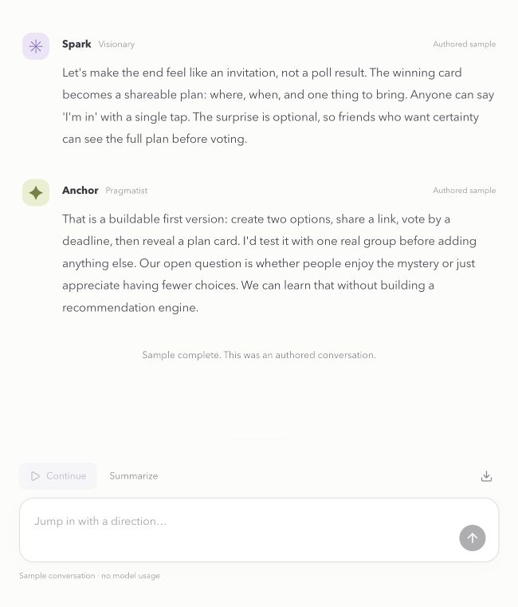

# Agent Arena · local edition

A minimal conversation between two AI agents. Describe something you want to make, watch Spark and Anchor respond to each other, and jump in with your own direction.



## Run it

Requires Node.js 22.13+ and a Codex account with available usage. The repository is private; testers need an invitation.

```sh
git clone --branch local https://github.com/vulpes922/agent-arena.git
cd agent-arena
npm ci
npm run local
```

The launcher uses the project's official Codex CLI and opens sign-in if needed. On this prepared Mac checkout, double-click `start-local.command` or run `./start-local.command`. Open the terminal's local URL and keep the terminal running. `npm run doctor` checks dependencies and sign-in.

## Use it

- Type your idea and start. Spark and Anchor take turns; each sees the preceding reply.
- Replies appear when each model call finishes. This is live inference, not token-by-token streaming.
- **Pause** cancels the in-progress reply. **Continue** resumes with the next agent, keeping all completed messages.
- Sending your own direction pauses the debate and adds it to the transcript. Continue when ready; the next agent receives that direction.
- Each run allows up to six replies, then pauses. Continue for another six. Each reply uses one Codex request and consumes your own account's allowance.
- Open **Agent settings** to choose a separate model for Spark and Anchor. Model suggestions come from the local Codex cache; you can also enter an exact model ID. Account availability is checked by Codex when you run a turn. Pause before changing models. Earlier messages keep their original model labels.
- **Summarize** adds an Orbit checkpoint without ending the conversation. Its model is independently selectable in settings, and it uses one request.
- Export the complete transcript as Markdown. The last 12 conversations are saved in this browser; open Recent conversations on the home screen to resume one.

The authored sample makes no model calls. Its replies are fixed and do not adapt to your notes. The original staged prototype and its existing saved arenas remain at `/classic` (linked from settings).

## Context and limits

The visible and exported transcript retains every message. Model requests include the mission, the latest 20 messages, and earlier human directions; agents may not recall older agent details. Restate a decision as a human direction if it must persist. A conversation supports up to 30 human directions. Requests have a 90 KB body limit and a 150-second timeout. Failed or cancelled replies are not added; completed replies remain available.

Local credentials stay with Codex. Agent subprocesses use ephemeral sessions, isolated configuration, temporary working directories, and disabled shell, web, app, plugin, browser, computer, hook, and multi-agent features. Agent roles are prompted perspectives, not separate authorities. The result is a discussion and product direction; this app does not automatically implement or deploy the proposed product.

## Branches

- `local`: live conversation, per-agent models, local onboarding.
- [online](https://github.com/vulpes922/agent-arena/tree/online): separately maintained hosted sample; visitor ChatGPT plan access has been requested and remains pending.
- `main`: original prototype baseline.

The hosted preview has not been replaced by this local edition.

## Development

```sh
npm test
npm run typecheck
npm run build
```

React 19, TypeScript, Vinext/Vite. The local Vite middleware supplies inference; production builds cannot use the computer's Codex account. `npm run dev` serves the local app; `npm start` serves a production preview without local inference.

- `app/page.tsx`, `app/conversation.css`: minimal conversation UI.
- `lib/conversation.mjs`: sequential turn runner, speaker selection, transcript export.
- `lib/conversation-contract.mjs`: bounded dialogue context and model prompt.
- `scripts/codex-provider.mjs`: account status, local model suggestions, cancellable model calls.
- `app/classic/page.tsx`: preserved original staged prototype.

Optional environment defaults: `ARENA_CODEX_BIN`, `ARENA_TEAM_MODEL`, `ARENA_MODERATOR_MODEL`. An explicit model choice in the interface takes priority.
