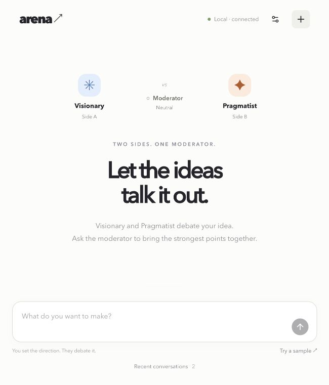
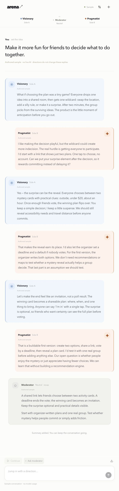

# Using Agent Arena

[Overview](../README.md) · [Install on Mac or Windows](SETUP.md) · [Development](DEVELOPMENT.md)

Agent Arena helps you develop an idea through a conversation between two AI perspectives. You provide the goal, watch their responses, and decide when to steer or ask for a recap. The result is a discussion and product direction; the app does not automatically build or deploy the product being discussed.

## The interface

Blue and orange distinguish the two sides. Their names are their selected perspectives: **Visionary** and **Pragmatist** by default. Either side can propose, challenge, or concede. The neutral **Moderator** summarizes the discussion when asked.

These are screenshots of the running local app. The conversation screenshot shows the **authored sample**, not a live AI result. The online edition shares the conversation layout but currently offers only this sample.

## Start your first live conversation

1. Start the local edition using the [setup guide](SETUP.md).
2. Open **Agent settings** and choose a perspective for each side before beginning.
3. Optionally choose a separate model for each agent and the Moderator.
4. Enter a goal with enough detail to debate, then select **Start live conversation**.
5. Read the alternating responses. Each agent sees the preceding reply.
6. Add your direction or pause whenever you want to steer the idea.
7. Ask the Moderator for a checkpoint and export the discussion when useful.

Example goal:

> Design a playful website that helps a group invent a weekend adventure. It should work from one shared link and be possible to prototype in two days.

Example direction:

> Keep the surprise element, but make the first version work without accounts or location tracking.

## Perspectives and models

Available perspectives are Visionary, Pragmatist, User advocate, Contrarian, Strategist, and Craftsperson. They guide the agents' behavior through prompts. They are not separate human experts, and agreement between agents is not independent fact checking.

Choose perspectives before starting a conversation. To use different perspectives later, start a new conversation. The sample always uses Visionary and Pragmatist.

In **Agent settings**, each side has a model field. Expand **Moderator model** for its separate choice. Suggestions come from the local Codex cache; you can enter an exact model ID. A suggestion is not a guarantee of access: Codex checks availability when a request runs. Leave a field blank to use the configured default.

Pause before changing models. New choices apply to subsequent replies; older messages retain their original model labels. You can use one model for all three participants or different models for each. Online model controls remain disabled while hosted inference is unavailable.

## Conversation controls

| Control | What happens |
| --- | --- |
| **Pause** | Cancels the current model request and discards its unfinished reply. Completed messages remain. |
| **Continue** | Resumes the same conversation with the next agent. A run allows up to six replies before pausing automatically. |
| **Add direction and pause** | Adds your note to the transcript and pauses the run. Continue when ready for the agents to use your direction. |
| **Ask moderator** | Adds a recap of both sides. It does not end the conversation. |
| **Export conversation** | Downloads the complete transcript as Markdown. |
| **New conversation** | Returns to a fresh idea; recent conversations can be reopened from the home screen. |

Replies become visible when each model call finishes; this prototype does not stream tokens. Every live agent reply uses one Codex request, and a moderator recap uses one more. Calls consume the signed-in account's allowance. Sample playback makes no model calls; its fixed replies do not change in response to your directions.

## Saved conversations and privacy

The last **12 conversations** are saved in the current browser's local storage. Open **Recent conversations** from the home screen to resume. There is no cloud backup, cross-device sync, or shared team history. Changing host, port, browser profile, or clearing site data can make the saved history unavailable. Export important results.

Live prompts and conversation context are sent to OpenAI through the signed-in Codex CLI. Local sign-in does not mean offline inference. Credentials remain managed by Codex; Agent Arena does not ask for your password or an API key in its interface.

Agent subprocesses use temporary working directories, ephemeral sessions, isolated configuration, and disabled shell, web, app, plugin, browser, computer, hook, and multi-agent features. They discuss the supplied idea rather than operating on your project files.

## Current limits

- The visible and exported transcript retains all completed messages. Requests include the mission, the latest 20 messages, and earlier human directions. Older agent details may fall outside the model context; restate essential decisions as a human direction.
- A conversation supports up to 30 human directions. Request bodies are limited to 90 KB, and model requests time out after 150 seconds.
- Failed or cancelled replies are not added to the transcript.
- The authored sample is finite; Continue is disabled when its replies are exhausted.
- Hosted ChatGPT-plan access has been requested but is not approved or implemented. Signing into the private online preview only grants access to the site.
- The original staged prototype remains available at `/classic` in the local edition, linked from settings.
